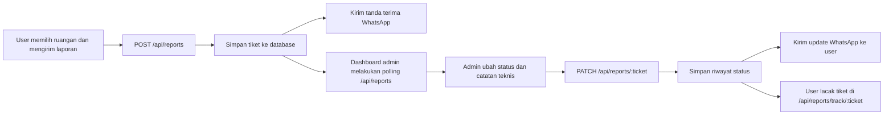

# APPAU - Sistem Pelayanan TIK

APPAU adalah singkatan dari Aplikasi Pelayanan Permintaan, Aduan, dan Utilitas TIK. Aplikasi ini dipakai untuk pelaporan gangguan jaringan pada SKPD/unit kerja, lalu admin dapat memantau antrean laporan, memberi catatan teknis, mengubah status, dan menyiapkan notifikasi WhatsApp otomatis.

## Menjalankan

```bash
npm install
npm start
```

Buka halaman user di `http://localhost:8890`.

Halaman admin terpisah di `http://localhost:8890/admin`.

Halaman admin memakai `ADMIN_KEY`. Default lokal:

```env
PORT=8890
ADMIN_KEY=admin123
STORAGE=mysql
DB_HOST=localhost
DB_USER=root
DB_PASSWORD=
DB_NAME=db-sppd
```

## Setup Database XAMPP

1. Buka XAMPP Control Panel.
2. Klik `Start` pada `Apache` dan `MySQL`.
3. Buka `http://localhost/phpmyadmin`.
4. Masuk tab `Import`.
5. Import file `database/setup_xampp.sql`.
6. Pastikan `.env` berisi `STORAGE=mysql` dan `DB_NAME=db-sppd`.
7. Jalankan ulang aplikasi:

```bash
npm start
```

Kalau PowerShell menolak `npm` karena execution policy, jalankan:

```bash
npm.cmd start
```

Catatan: XAMPP default biasanya memakai user `root` tanpa password. Jika MySQL Anda diberi password, isi `DB_PASSWORD` di `.env`.

## Stack yang Direkomendasikan

Untuk versi ringan dan cepat dipakai:

- Frontend: HTML, CSS, JavaScript vanilla atau Tailwind CSS jika nanti memakai build step.
- Backend: Node.js + Express.
- Database awal: JSON file untuk prototipe, lalu migrasi ke MySQL/PostgreSQL untuk produksi.
- Realtime: polling 10-15 detik sudah cukup untuk tahap awal; Socket.IO bisa ditambahkan jika volume tinggi.
- WhatsApp: Meta WhatsApp Cloud API untuk jalur resmi; alternatif integrator/gateway dapat dipasang lewat mode webhook.

Untuk produksi:

- Frontend: React/Vite atau Next.js jika butuh role, routing, audit view, dan komponen besar.
- Backend: Express/NestJS/Laravel.
- Database: PostgreSQL atau MySQL.
- Queue: BullMQ/Redis untuk retry notifikasi WhatsApp.
- Auth: session/JWT dengan role `admin`, `technician`, dan `viewer`.

## Impor Data Ruangan dari Excel

Sumber utama ruangan ada di `data/rooms.json` dan endpoint `GET /api/rooms`.

Untuk mode XAMPP/MySQL, sumber utama ruangan ada di tabel `rooms`. File `database/setup_xampp.sql` sudah berisi struktur tabel dan 69 data ruangan/SKPD dari Excel.

Cara paling aman untuk tahap awal:

1. Rapikan Excel dengan kolom: `kode`, `ruangan`, `gedung`, `lantai`.
2. Export Excel ke CSV.
3. Login admin, lalu upload CSV lewat bagian "Data Ruangan".
4. Dropdown user otomatis mengambil data dari `/api/rooms`.

Endpoint import:

```http
POST /api/rooms/import
Header: X-Admin-Key: <ADMIN_KEY>
Body multipart: rooms=<file.csv atau file.json>
```

Jika ingin menerima `.xlsx` langsung, tambahkan parser seperti SheetJS (`xlsx`) di backend dan ubah fungsi `parseRooms()`.

## Alur Data



## Skema Database Sederhana

Tabel `rooms`:

- `id`
- `code`
- `name`
- `building`
- `floor`
- `is_active`
- `created_at`
- `updated_at`

Tabel `reports`:

- `id`
- `ticket_no`
- `room_id`
- `location_text`
- `category`
- `reporter_name`
- `contact_phone`
- `detail`
- `status`
- `assigned_to`
- `created_at`
- `updated_at`
- `resolved_at`

Tabel `report_logs`:

- `id`
- `report_id`
- `status`
- `note`
- `created_by`
- `created_at`

Tabel `whatsapp_notifications`:

- `id`
- `report_id`
- `phone`
- `message`
- `provider`
- `provider_message_id`
- `status`
- `error_message`
- `created_at`
- `sent_at`

Tabel `users`:

- `id`
- `name`
- `username`
- `password_hash`
- `role`
- `is_active`

## WhatsApp Configuration

Mode nonaktif adalah default. Aplikasi tetap berjalan dan log server menampilkan pesan:

```text
[WA disabled] TIK-08-08-2026-001 -> 62812xxxx: Laporan Anda telah diterima...
```

Mode Meta Cloud API:

```env
WHATSAPP_PROVIDER=meta
WHATSAPP_META_TOKEN=...
WHATSAPP_PHONE_NUMBER_ID=...
WHATSAPP_GRAPH_VERSION=v20.0
```

Mode gateway webhook:

```env
WHATSAPP_PROVIDER=webhook
WHATSAPP_WEBHOOK_URL=https://gateway.example.com/send
WHATSAPP_WEBHOOK_TOKEN=...
```

Payload webhook:

```json
{
  "to": "62812xxxxxxxx",
  "message": "Pembaruan laporan TIK-08-08-2026-001...",
  "ticketId": "TIK-08-08-2026-001"
}
```

## Endpoint Utama

| Method | Endpoint | Akses | Fungsi |
| --- | --- | --- | --- |
| GET | `/api/rooms` | publik | daftar ruangan |
| POST | `/api/rooms/import` | admin | import ruangan CSV/JSON |
| POST | `/api/reports` | publik | buat laporan |
| GET | `/api/reports/track/:ticket` | publik | lacak tiket |
| GET | `/api/board` | publik | status gangguan aktif |
| GET | `/api/reports` | admin | daftar laporan lengkap |
| PATCH | `/api/reports/:ticket` | admin/petugas | ubah status dan catatan |

## Catatan UI/UX

Desain saat ini dibuat sebagai aplikasi internal, bukan landing page:

- warna netral navy/slate;
- tanpa glow gradient, tema ungu/biru AI, atau glassmorphism berlebihan;
- form user langsung muncul sebagai fungsi utama;
- dashboard admin berada di halaman terpisah `/admin`;
- teks ringkas dan orientasi pekerjaan harian.
